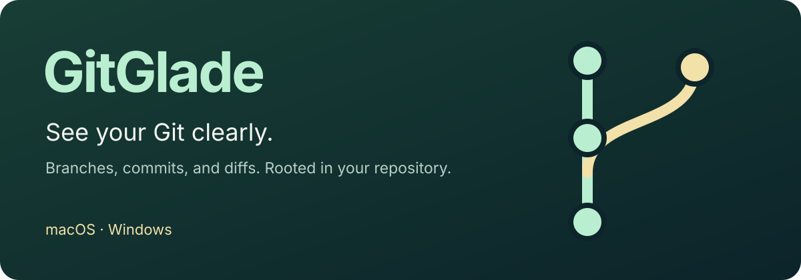

<p align="center">
  
</p>

<p align="center">
  <a href="https://github.com/yyyzl/gitglade/actions/workflows/build.yml"></a>
  · <a href="LICENSE">MIT</a>
  · <a href="https://yyyzl.github.io/gitglade/">Downloads</a>
  · <a href="docs/usage.md">Usage</a>
  · <a href="CONTRIBUTING.md">Contributing</a>
  · <a href="skills/gitglade/SKILL.md">Agent Skill</a>
  · <a href="README.md">简体中文</a>
</p>

**GitGlade is a desktop viewer for local Git repositories.** Open a project to inspect its current branch, working tree changes, commit history, and file diffs. Keep using Git in your editor, terminal, or agent; GitGlade follows changes made to the real repository.

## What you can inspect

| Question                      | GitGlade shows                                                                                           |
| ----------------------------- | -------------------------------------------------------------------------------------------------------- |
| Which branch am I on?         | The commit graph, parent relationships, local branches, tags, and `HEAD`                                 |
| What changed in this project? | Files grouped by merge conflicts, staged changes, and working tree changes                               |
| What does a commit contain?   | Its changed files, diff, author, date, and parent commits                                                |
| How did a file change?        | Side-by-side or unified text diffs with original line numbers; image comparison; media and byte previews |
| What is the repository state? | Worktrees, stashes, merge or rebase state, and locally recorded upstream counts                          |

## Interface

Repository names, branches, commit messages, paths, and author details remain exactly as Git records them when the interface language changes.

The left sidebar switches between the working tree, commit history, and branch comparison. Choose a commit and one of its changed files on the left; both views share the full diff reader on the right. Branch and tag filters only change the displayed history. Switching worktrees keeps the original project and recent-project entry while observing the selected directory.

The interface supports English and Simplified Chinese. It follows the system language on first launch, then remembers the language you choose. Dark, light, and green themes are available as well.

## Install

Download verified installers from [GitGlade GitHub Releases](https://github.com/yyyzl/gitglade/releases/latest):

- **Windows x64:** `GitGlade_*_x64-setup.exe`.
- **macOS (Apple Silicon and Intel):** `GitGlade_*_universal.dmg`.

Release assets are separate from the temporary CI artifacts and remain available unless the release or assets are deleted. Release notes identify the source version.

For unreleased commits, use [GitHub Actions build artifacts](https://github.com/yyyzl/gitglade/actions/workflows/build.yml):

1. Open **Desktop CI** and select a successful run for `main`. Check the commit matches the version you want.
2. In **Artifacts**, download `installers-windows-x64` for Windows x64 or `installers-macos-universal` for macOS (Apple Silicon and Intel). You must be signed in to GitHub to download artifacts.
3. Extract the downloaded ZIP, then run the Windows `*setup.exe` installer or open the macOS `.dmg`.

Artifacts are retained for **14 days**. If an artifact has expired, trigger a new run using **Run workflow**, or [build from source](docs/development.md). Pushes and pull requests automatically trigger checks; when all checks pass, the workflow builds both installers and verifies the installed CLI on Windows and both macOS architectures. A failed run may not produce installers.

Git must be installed on the computer. The packaged app does not require Python, Node.js, or Rust at runtime.

Open a project from the toolbar or press **⌘ O** on macOS or **Ctrl O** on Windows. Selecting a directory inside a repository opens its owning repository. Use **⌘ R** or **Ctrl R** to refresh.

## Agent and CLI

The packages include a CLI and the [GitGlade Agent Skill](skills/gitglade/SKILL.md). The CLI can open a project in the existing app window or print a read-only JSON snapshot:

```sh
gitglade open . --view changes
gitglade open . --view history
gitglade inspect . --json
gitglade skill --path
gitglade --lang en --help
```

Use `--lang en` or `--lang zh-CN` with CLI commands to choose the language explicitly. Without it, each invocation reads the locale environment variables and defaults to English when none are set. This is independent of the saved interface language. `inspect` reads the local repository and does not open the app. The Skill is included with the package; installing GitGlade does not change the host agent's settings. See the [CLI guide](docs/usage.md#cli-and-ai-agents) for launcher paths and integration details.

## Repository access

Viewing, branch comparison, and the CLI are read-only. **Update branch** checks the selected remote branch, then updates the current worktree branch only after you confirm a fast-forward. Divergence, changed tracked files, or an active Git operation stop the update; local commits are retained. This flow does not change upstream configuration, run repository hooks, or download LFS content. Updates requiring content filters must be performed in your Git tool. There are no commit, stage, checkout, rebase, reset, stash, or push commands.

- Standard Git LFS pointers are read with the app's built-in read-only filter. The app shows object IDs and sizes without downloading file contents. Custom LFS commands and extensions are unsupported.
- Repository-defined external content filters and converters are not run. If a filter prevents a safe read, the app explains the limitation.
- Bare and partial-clone repositories are not supported. Upstream ahead/behind counts use local tracking records and do not imply a fetch.

See the [usage guide](docs/usage.md#compare-files) for file comparison, media previews, and read limits.

## Development

GitGlade uses Tauri 2, React, TypeScript, and Rust. Rust reads repositories through the system Git executable. The packaged app does not start a local HTTP server.

```sh
npm ci
npm run desktop
```

Development requires Node.js 22, Rust, and the Tauri dependencies for your platform. Read the [development guide](docs/development.md) and [usage guide](docs/usage.md), or their [Simplified Chinese versions](docs/zh-CN/development.md) and [中文使用说明](docs/zh-CN/usage.md). See [Contributing](CONTRIBUTING.md) before making changes.

## Publishing a release

Push a new version tag in `vMAJOR.MINOR.PATCH` format (for example, `v0.1.2`) to this repository. After all platform checks, packaging, and installed-CLI verification succeed, **Desktop CI** creates a GitHub Release and uploads the Windows installer, macOS universal DMG, and `SHA256SUMS.txt`. Existing releases are not overwritten. Ordinary branch pushes do not publish releases. Update the application version before tagging a new version.

Alternatively, run **Desktop CI → Run workflow** on `main` with `release_version` set to `v0.1.2` (or the exact current application version). Leaving it empty runs CI without publishing. An explicit release request must match every package/app version and pass the same full pipeline before the workflow atomically creates a new tag at the tested commit and publishes the installers. Existing tags or releases are never reused by this manual path. A publication failure after tag creation requires inspection; do not delete or move tags to retry blindly.

## License

[MIT](LICENSE). File type icons come from [Material Icon Theme](https://github.com/material-extensions/vscode-material-icon-theme). See [third-party notices](THIRD-PARTY-NOTICES.md) for other bundled materials.

## Credits

GitGlade is independently maintained and derived from [oil-oil/oil-git](https://github.com/oil-oil/oil-git). Original MIT copyright and third-party notices are preserved.
