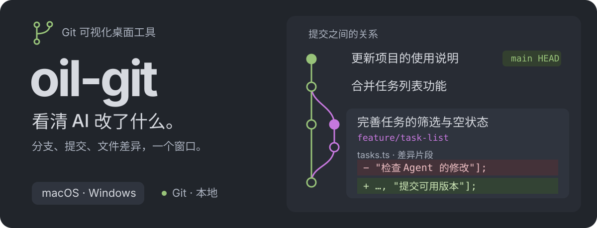

<p align="center">
  
</p>

<p align="center">
  <a href="https://github.com/yyyzl/gitglade/actions/workflows/build.yml"></a>
  · <a href="LICENSE">MIT</a>
  · <a href="https://yyyzl.github.io/gitglade/">下载</a>
  · <a href="docs/zh-CN/usage.md">使用说明</a>
  · <a href="docs/zh-CN/contributing.md">贡献指南</a>
  · <a href="skills/gitglade/SKILL.zh-CN.md">Agent Skill</a>
  · <a href="README.md">English</a>
</p>

**GitGlade 是一个本地 Git 仓库可视化桌面工具。** 打开项目即可查看当前分支、工作区更改、提交历史和文件差异。你继续在编辑器、终端或 Agent 中使用 Git，GitGlade 会跟随真实仓库的变化更新。

## 可以查看什么

| 你想确认           | GitGlade 展示什么                                                   |
| ------------------ | ------------------------------------------------------------------- |
| 当前在哪个分支     | 提交图、父子关系、本地分支、标签与 `HEAD`                           |
| 项目改了哪些内容   | 按合并冲突、已暂存更改和工作区更改分组的文件                        |
| 一次提交包含什么   | 变更文件、差异、作者、时间和父提交                                  |
| 文件具体如何变化   | 保留原始行号的左右对照或统一文本差异、图片对比，以及媒体和字节预览  |
| 仓库目前是什么状态 | 工作树、stash、合并或 rebase 状态，以及本地已有的上游领先／落后记录 |

左侧切换“工作区”“提交历史”和“分支对比”；在历史中选择提交及其变更文件，两种来源共用右侧完整的 diff 阅读区。分支和标签只筛选显示的历史。切换工作树保持原项目与最近项目记录，仅查看选中目录，不切换分支。

界面支持英文和简体中文。首次启动时根据系统语言选择，之后会记住你的手动设置。也支持深色、浅色和绿色主题。

切换界面语言不会翻译仓库名称、分支、提交信息、路径或作者等 Git 原始内容。

## 安装

从[GitGlade GitHub Releases](https://github.com/yyyzl/gitglade/releases/latest) 下载已验证的安装包：

- **Windows x64：** `GitGlade_*_x64-setup.exe`。
- **macOS（Apple Silicon 和 Intel）：** `GitGlade_*_universal.dmg`。

Release 附件与临时 CI 产物独立，不受 CI 的 14 天保留期限限制；除非删除 Release 或附件，否则可持续下载。对应源码版本见发布说明。

尚未发布的提交可通过 [GitHub Actions 构建产物](https://github.com/yyyzl/gitglade/actions/workflows/build.yml) 下载：

1. 打开 **Desktop CI**，选择 `main` 分支上成功的构建，确认提交对应你需要的版本。
2. 在页面的 **Artifacts** 区域，Windows x64 下载 `installers-windows-x64`；macOS（Apple Silicon 和 Intel）下载 `installers-macos-universal`。下载构建产物需要登录 GitHub。
3. 解压下载的 ZIP，运行 Windows 的 `*setup.exe` 安装器，或打开 macOS 的 `.dmg`。

构建产物保留 **14 天**。若已过期，可通过 **Run workflow** 手动触发新构建，或[从源码构建](docs/zh-CN/development.md)。推送代码和提交 Pull Request 会自动触发检查；全部检查通过后，工作流构建两个平台的安装包，并在 Windows 和两种 macOS 架构上验证安装后的 CLI。失败的构建可能不会生成安装包。

电脑需要已安装 Git；运行打包后的应用不需要 Python、Node.js 或 Rust。

从工具栏打开项目，或按 macOS **⌘ O**、Windows **Ctrl O**。选择仓库内的子目录也会打开所属仓库。按 **⌘ R** 或 **Ctrl R** 刷新。

## Agent 与 CLI

安装包包含 CLI 和 [GitGlade Agent Skill](skills/gitglade/SKILL.zh-CN.md)。CLI 可以在现有应用窗口打开项目，或输出只读 JSON 快照：

```sh
gitglade open . --view changes
gitglade open . --view history
gitglade inspect . --json
gitglade skill --path
gitglade --lang zh-CN --help
```

可对 CLI 命令使用 `--lang en` 或 `--lang zh-CN` 指定语言；不指定时每次读取环境变量中的区域设置，未设置时使用英文；这与界面中保存的语言偏好独立。`inspect` 只读取本地仓库，不会打开窗口。Skill 随安装包提供，安装 GitGlade 不会修改 Agent 宿主设置。启动器路径和接入方式见 [CLI 使用说明](docs/zh-CN/usage.md#cli-与-ai-agent)。

## 仓库访问边界

查看、分支对比和 CLI 保持只读。“更新分支”先检查所选远端分支，在你确认后仅快进更新当前工作树分支。分叉、已跟踪文件有更改或正在进行 Git 操作时停止更新，保留本地提交。此流程不修改上游配置、不运行仓库 hook、不下载 LFS 内容；需要内容过滤器转换的更新交给 Git 工具完成。应用没有提交、暂存、checkout、rebase、reset、stash 或 push 命令。

- 标准 Git LFS 指针由应用自带的只读过滤器读取。应用展示对象 ID 和大小，不下载文件内容；自定义 LFS 命令与扩展暂不支持。
- 不运行仓库配置的外部内容过滤器或转换程序。若过滤器阻止安全读取，应用会说明限制。
- 暂不支持裸仓库和部分克隆仓库。上游领先／落后数量来自本地跟踪记录，不代表执行了 fetch。

文件差异、媒体预览和读取上限见[使用说明](docs/zh-CN/usage.md#文件差异)。

## 开发

GitGlade 使用 Tauri 2、React、TypeScript 和 Rust。Rust 通过系统 Git 读取仓库，打包后的应用不启动本地 HTTP 服务。

```sh
npm ci
npm run desktop
```

开发需要 Node.js 22、Rust 和当前平台的 Tauri 开发依赖。参阅[开发文档](docs/zh-CN/development.md)和[使用说明](docs/zh-CN/usage.md)，也可阅读英文版[开发文档](docs/development.md)与[使用说明](docs/usage.md)。贡献前请阅读[贡献指南](docs/zh-CN/contributing.md)。

## 发布版本

向本 Fork 推送新的 `v主版本.次版本.修订号` 标签（如 `v0.1.1`）。所有平台检查、打包及安装后 CLI 验证通过后，**Desktop CI** 自动创建 GitHub Release，上传 Windows 安装器、macOS 通用 DMG 和 `SHA256SUMS.txt`。已有 Release 不会被覆盖；普通分支推送不会发布版本。发布新版本前应先更新应用版本号。

## 许可证

[MIT](LICENSE)。文件类型图标来自 [Material Icon Theme](https://github.com/material-extensions/vscode-material-icon-theme)，其他随附素材见[第三方声明](docs/zh-CN/third-party-notices.md)。

## 致谢

GitGlade 独立维护，源自 [oil-oil/oil-git](https://github.com/oil-oil/oil-git)。保留原始 MIT 版权与第三方许可声明。

### 手动触发发布

也可在 `main` 上选择 **Desktop CI → Run workflow**，将 `release_version` 填为 `v0.1.1`（或应用当前的准确版本）。留空只运行 CI，不发布。非空版本必须与所有应用／包版本一致，并通过完整检查、打包与安装后验证，才会在已测试提交上原子创建新标签并发布安装包。手动路径不会复用或覆盖现有标签、Release。若创建标签后发布失败，应先检查原因，不要盲目删除或移动标签重试。
